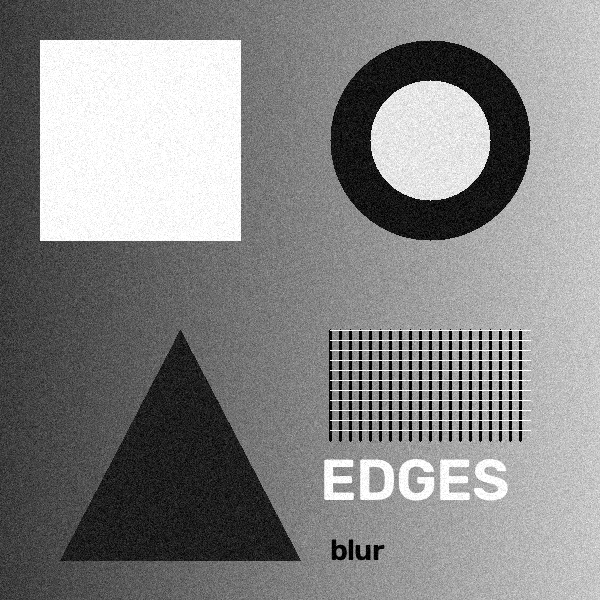
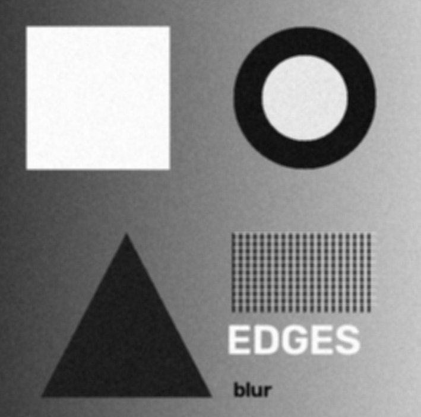
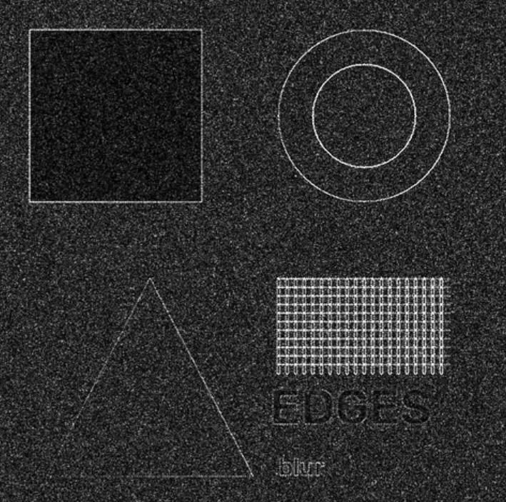
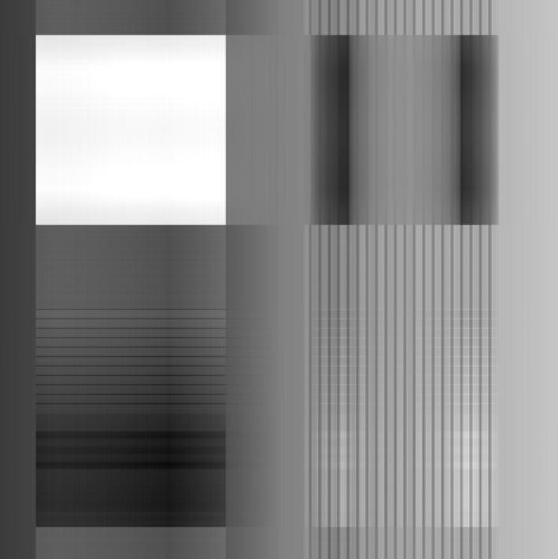
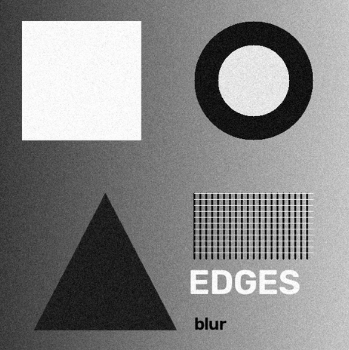

# Informe de uso: Procesador de Imágenes con Tkinter y PCA

**EIN092B: Laboratorio Sesión 12**

**Grupo:** G5
**Integrantes:**
- Lukas Garrido
- Octavio Valencia 

**Fecha:** 07-11-2026

---

## 1. Imagen original cargada

*Figura 1: Imagen original cargada.*

---

## 2. Filtro de suavizado (Blur)

*Figura 2: Filtro de suavizado (Blur), kernel promedio 5×5.*

**¿Qué se ve?** La misma imagen con bordes menos nítidos, menos ruido granulado, y la rejilla y el texto más difusos.
**¿Por qué?** Cada píxel se reemplaza por el promedio de sus 25 vecinos (kernel 5×5 con pesos 1/25). Esto atenúa los cambios bruscos de intensidad (bordes y ruido), que son las componentes de alta frecuencia.

---

## 3. Filtro de bordes (Laplace)

*Figura 3: Filtro de bordes (Laplace), kernel 3×3.*

**¿Qué se ve?** Los contornos de las figuras como líneas finas claras sobre fondo oscuro, la rejilla muy brillante y un grano de fondo.
**¿Por qué?** El kernel laplaciano compara cada píxel con sus 4 vecinos: da valores cercanos a 0 en zonas uniformes y altos donde hay cambios bruscos. El grano proviene del ruido de la imagen original, que este filtro amplifica.

---

## 4. Reconstrucción con PCA

### 4.1 k = 1

*Figura 4: Reconstrucción PCA con k = 1.*

**¿Qué se ve?** Franjas verticales y bloques; las figuras apenas se insinúan.
**¿Por qué?** Con una sola componente principal, toda la imagen se reconstruye a partir de un único patrón, más la media. Retiene cerca del 63 % de la varianza, pero eso no basta para recuperar el detalle.

### 4.2 k = 300 (la mitad)

*Figura 5: Reconstrucción PCA con k = 300.*

**¿Qué se ve?** Una imagen prácticamente igual a la original: formas, texto y rejilla nítidos.
**¿Por qué?** Con 300 componentes se retiene más del 99 % de la varianza. Lo que falta es información de muy poca energía, casi imperceptible.

### 4.3 k = 600

*Figura 6: Reconstrucción PCA con k = 600 (máximo).*

**¿Qué se ve?** Una imagen idéntica a la original.
**¿Por qué?** 600 es el número máximo de componentes (el menor lado de la imagen), así que no se descarta información y la reconstrucción es exacta.

---

## 5. Observaciones

- **Blur y Laplace son operaciones opuestas.** El suavizado promedia los píxeles vecinos y elimina las altas frecuencias (ruido y detalle fino), mientras que Laplace conserva solo los cambios bruscos de intensidad. Por eso Blur reduce el ruido y Laplace lo hace más visible.

- **Laplace es muy sensible al ruido.** En la Figura 3 el fondo, que en la imagen original es un degradado suave, aparece con grano. Esto ocurre porque el Laplaciano es una derivada de segundo orden y amplifica cualquier variación local, sea borde real o ruido.

- **El suavizado tiene un costo en nitidez.** En la Figura 2 el ruido disminuye, pero la rejilla fina y el texto pierden definición. Reducir ruido y conservar detalle son objetivos que se contraponen.

- **Los filtros y el PCA son independientes.** La aplicación siempre procesa a partir de la imagen original, de modo que el resultado de cada acción no depende de la anterior.

- **En PCA, las primeras componentes capturan la estructura global.** Con k = 1 solo se reconstruye un patrón dominante (franjas y bloques), mientras que los detalles finos, como el texto y la rejilla, requieren muchas más componentes.

- **El retorno de agregar componentes decrece.** Entre k = 300 y k = 600 la diferencia visual es casi nula, aunque se usa el doble de componentes. Esto muestra que PCA permite comprimir la imagen descartando componentes de baja varianza sin una pérdida perceptible.

- **k = 600 es el máximo posible.** Corresponde al menor lado de la imagen (`min(alto, ancho)`), por lo que la reconstrucción es exacta y equivale a no comprimir.

---

## Referencias

[1] Python Software Foundation. tkinter — Python interface to Tcl/Tk. https://docs.python.org/3/library/tkinter.html

[2] Scikit-learn: Machine Learning in Python. sklearn.decomposition.PCA. https://scikit-learn.org/stable/modules/generated/sklearn.decomposition.PCA.html

[3] OpenCV (2025). OpenCV Python Tutorials. https://docs.opencv.org/4.x/d6/d00/tutorial_py_root.html